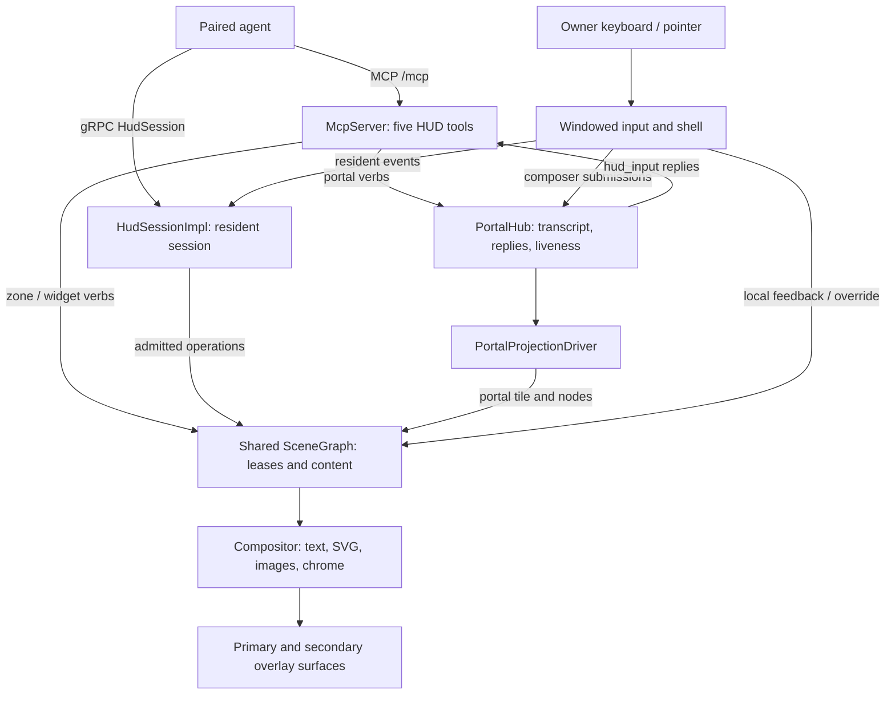

# Architecture and code map

For contributors finding the owner of a behavior before changing it. The
Windows `tze_hud` app hosts both agent protocols and owns the overlay, scene,
input and rendering. Agents send intent; they do not run the frame loop.
The four surfaces and their contracts are in [api.md](api.md); current
implementation gaps are in [scope.md](scope.md).

[Observed] This map was checked against `855f8397` on 2026-10-13. Links point
to interface owners rather than a full call graph. Update affected rows and
flows when ownership or observable behavior changes. Planned behavior belongs
in scope; historical designs at `pre-reset-2026-10-02` are not requirements.

## Runtime flow

These are ownership/data-flow arrows, not Cargo dependencies. Startup and
network wiring live in the [app](../app/tze_hud_app/src/main.rs),
[windowed runtime](../crates/tze_hud_runtime/src/windowed/mod.rs), and its
[network bootstrap](../crates/tze_hud_runtime/src/windowed/network.rs).
The API handlers are
[`McpServer`](../crates/tze_hud_mcp/src/server.rs) and
[`HudSessionImpl`](../crates/tze_hud_protocol/src/session_server/mod.rs).

## Where changes belong

[Observed] The [workspace manifest](../Cargo.toml) contains eleven core
crates, the canonical app, five examples and a separate integration package.

| Owner | Responsibility and entry point |
|---|---|
| `app/tze_hud_app` | Canonical binary, CLI, config selection and operator startup actions: [main.rs](../app/tze_hud_app/src/main.rs) |
| `tze_hud_runtime` | Window/event-loop lifecycle, protocol wiring, portal driver, shell (including the [control panel](../crates/tze_hud_runtime/src/shell/control_panel/mod.rs) model and its sections), deadlines and operator services: [lib.rs](../crates/tze_hud_runtime/src/lib.rs), [windowed](../crates/tze_hud_runtime/src/windowed/mod.rs) |
| `tze_hud_scene` | Shared scene graph, tiles/nodes/zones, leases, agent identity, the owner's visibility set and per-agent holdings and Clear: [SceneGraph](../crates/tze_hud_scene/src/graph/mod.rs), [visibility](../crates/tze_hud_scene/src/graph/visibility.rs), [agents](../crates/tze_hud_scene/src/graph/agents.rs), [lease](../crates/tze_hud_scene/src/lease/), [config](../crates/tze_hud_scene/src/config/) |
| `tze_hud_mcp` | Discover, publish, clear, hold and input tools, with caller-scoped authorization and shared errors: [tools.rs](../crates/tze_hud_mcp/src/tools.rs) |
| `tze_hud_protocol` | Protobuf schemas, resident session lifecycle, atomic mutations, resume and event delivery: [proto](../crates/tze_hud_protocol/proto/), [session_server](../crates/tze_hud_protocol/src/session_server/mod.rs) |
| `tze_hud_projection` | `PortalHub` state and transitional resident rendering code: [hub.rs](../crates/tze_hud_projection/src/hub.rs), [lib.rs](../crates/tze_hud_projection/src/lib.rs) |
| `tze_hud_input` | Hit testing, focus, pointer/keyboard processing, scrolling and composer editing: [lib.rs](../crates/tze_hud_input/src/lib.rs) |
| `tze_hud_compositor` | GPU draw/present, text shaping, markdown, widget rasterization, per-display targets and the control panel's layout and drawing: [lib.rs](../crates/tze_hud_compositor/src/lib.rs), [control_panel.rs](../crates/tze_hud_compositor/src/renderer/control_panel.rs) |
| `tze_hud_config` | Validated config, profiles, zone/widget definitions, design tokens, themes and agent-file loading: [lib.rs](../crates/tze_hud_config/src/lib.rs) |
| `tze_hud_widget` | SVG templates, parameter types and widget rendering support: [lib.rs](../crates/tze_hud_widget/src/lib.rs) |
| `tze_hud_resource` | Content-addressed resources, upload validation, widget asset storage and resident-memory accounting: [lib.rs](../crates/tze_hud_resource/src/lib.rs) |
| `tze_hud_telemetry` | Frame timing and telemetry aggregation: [lib.rs](../crates/tze_hud_telemetry/src/lib.rs) |
| `tests/integration` | Cross-crate behavior, POC acceptance and token footprint: [manifest](../tests/integration/Cargo.toml). Crate-scoped checks do not compile this separate package. |

## Boundaries that matter

**Identity and deployment [Observed].** The app loads `agents.toml` beside
its config; pairing adds an agent with a hashed PSK, and the control panel
unpairs agents and edits allow lists, both through one
[`AgentStore`](../crates/tze_hud_runtime/src/agent_store.rs) writer. MCP and
gRPC share [`SharedAgents`](../crates/tze_hud_scene/src/config/agents.rs).
Network listeners bind loopback and local Tailscale-interface addresses
([`net_addrs`](../crates/tze_hud_runtime/src/net_addrs.rs)).
[`http::route`](../crates/tze_hud_runtime/src/http.rs) keeps `/pair` and
admin-authorized `/admin/*` outside the five MCP tools. Installation, firewall,
restart and signed-update semantics belong in the
[Windows runbook](operations/windows-install.md), not in agent payloads.

**Portal state [Observed].**
[`PortalHandle`](../crates/tze_hud_mcp/src/server.rs) shares one hub, clock
and per-agent input Notify registry between MCP and
[`PortalProjectionDriver`](../crates/tze_hud_runtime/src/portal_projection_driver.rs).
The driver stores and clones that complete handle. Composer admission commits
input and reply history under the hub lock, then signals the owning agent after
unlock. Notification actions return an agent readiness callback that the pointer
producer invokes after scene and shared-state unlock; queues remain authoritative.
Input readiness is separate from render/main-work wake delivery. `hud_input`
arms the agent Notify before checking retained action and portal queues, releases
model guards before awaiting, and rechecks once at its unchanged absolute deadline.
An active finite poll defers only its own agent's idle degradation, including a
first attachment during that wait. Per-request ownership drops on return or
cancellation without writing future activity; explicit upstream degradation,
reclaim, clear and input expiry keep their existing semantics. Zero portals add
no periodic runtime wake. Local accepted replies and truthful rejection feedback
bypass output pacing once; the actual Winit settle order flushes the composer
before portal drain. Hub reply history owns the echo, so raw-tile echo is skipped.
Notification input retains Callback versus human-X Dismiss through MCP
serialization. Only a validated X that removed its exact publication emits the
runtime kind; callback auto-removal, TTL and clear do not.
The hub is keyed by authenticated agent and portal id; its time-dependent
operations take injected time. The driver materializes scene tiles, mirrors
liveness onto leases, and connects composer submissions back to the hub.
It still renders through `ResidentGrpcPortalAdapter`; deleting that adapter
is remaining T7 work, not an already completed boundary change.

**Input and reclaim [Observed].** Local input is handled by the
[windowed keyboard](../crates/tze_hud_runtime/src/windowed/keyboard.rs) and
[input dispatch](../crates/tze_hud_runtime/src/windowed/input_dispatch.rs)
paths. Resident events use
[`InputEventSender`](../crates/tze_hud_protocol/src/session_server/input_event_bus.rs)
with ordered transactional queues and a separate droppable lane. Disconnect,
resume, lease expiry and human override have distinct semantics; their
regression anchors are in [invariants.md](invariants.md). A transport refactor
must preserve these boundaries.

**Configuration and pixels [Observed].**
[`RuntimeContext`](../crates/tze_hud_runtime/src/runtime_context.rs) supplies
startup profile limits. Themes resolve defaults → selected theme → explicit
overrides ([`themes`](../crates/tze_hud_config/src/themes.rs)); font and theme
choices currently take effect at startup. Per-monitor overlays share a scene
in physical desktop coordinates
([`displays`](../crates/tze_hud_runtime/src/windowed/displays.rs)). Do not infer
live theme switching, EDID-based config keys or full logical-DPI scaling from
the presence of helper modules; their status is recorded in [scope.md](scope.md).

## Verification and navigation

[Observed] [README](../README.md) maps the local `just` commands to CI.
[Invariants](invariants.md) links behavior contracts to tests;
[Windows development](development/windows.md) records platform differences.
Use [QUICKSTART](QUICKSTART.md) to run a session and
[Windows installation](operations/windows-install.md) to operate the shipped
app. Headless/llvmpipe tests, Windows WARP captures and owner-host acceptance
provide different evidence; none alone establishes all three.
