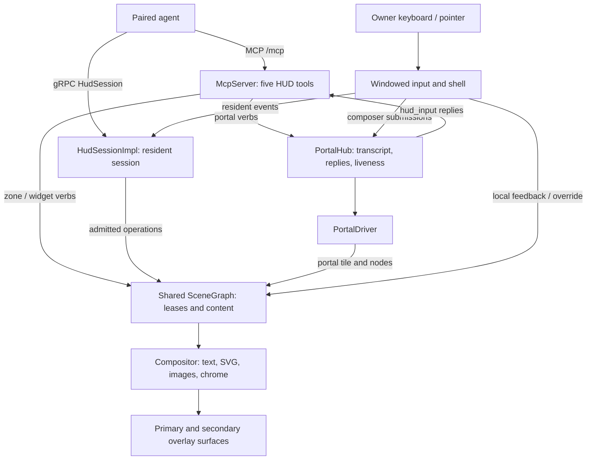

# Architecture and code map

For contributors finding the owner of a behavior before changing it. The
Windows `tze_hud` app hosts both agent protocols and owns the overlay, scene,
input and rendering. Agents send intent; they do not run the frame loop.
The three surfaces and their contracts are in [api.md](api.md); current
implementation gaps are in [scope.md](scope.md).

[Observed] This map was checked against `855f8397` on 2026-10-13. Links point
to interface owners rather than a full call graph. Update affected rows and
flows when ownership or observable behavior changes. Planned behavior belongs
in scope; historical designs at `pre-reset-2026-10-02` are not requirements.

## Runtime flow

The runtime returns per-frame telemetry to its caller and records cumulative
session totals with bounded recent latency samples; the collector retains no
frame history. Headless benchmarks own their artifact samples separately.

These are ownership/data-flow arrows, not Cargo dependencies. Startup and
network wiring live in the [app](../app/tze_hud_app/src/main.rs),
[windowed runtime](../crates/tze_hud_runtime/src/windowed/mod.rs), and its
[network bootstrap](../crates/tze_hud_runtime/src/windowed/network.rs).
The API handlers are
[`McpServer`](../crates/tze_hud_mcp/src/server.rs) and
[`HudSessionImpl`](../crates/tze_hud_protocol/src/session_server/mod.rs).

## Where changes belong

[Observed] The [workspace manifest](../Cargo.toml) contains eleven core
crates, the canonical app, five examples and a separate integration package.

| Owner | Responsibility and entry point |
|---|---|
| `app/tze_hud_app` | Canonical binary, CLI, config selection and operator startup actions: [main.rs](../app/tze_hud_app/src/main.rs) |
| `tze_hud_runtime` | Window/event-loop lifecycle, protocol wiring, portal driver, shell (including the [control panel](../crates/tze_hud_runtime/src/shell/control_panel/mod.rs) model and its sections), deadlines and operator services: [lib.rs](../crates/tze_hud_runtime/src/lib.rs), [windowed](../crates/tze_hud_runtime/src/windowed/mod.rs) |
| `tze_hud_scene` | Shared scene graph, tiles/nodes/zones, leases, agent identity, the owner's visibility set and per-agent holdings and Clear: [SceneGraph](../crates/tze_hud_scene/src/graph/mod.rs), [visibility](../crates/tze_hud_scene/src/graph/visibility.rs), [agents](../crates/tze_hud_scene/src/graph/agents.rs), [lease](../crates/tze_hud_scene/src/lease/), [config](../crates/tze_hud_scene/src/config/) |
| `tze_hud_mcp` | Discover, publish, clear, hold and input tools, with caller-scoped authorization and shared errors: [tools.rs](../crates/tze_hud_mcp/src/tools.rs) |
| `tze_hud_protocol` | Protobuf schemas, resident session lifecycle, zone/widget publication, resource uploads, resume and event delivery: [proto](../crates/tze_hud_protocol/proto/), [session_server](../crates/tze_hud_protocol/src/session_server/mod.rs) |
| `tze_hud_portal` | `PortalHub` state, pure scene-node renderer and resolved visual tokens: [hub.rs](../crates/tze_hud_portal/src/hub.rs), [render.rs](../crates/tze_hud_portal/src/render.rs), [tokens.rs](../crates/tze_hud_portal/src/tokens.rs) |
| `tze_hud_input` | Hit testing, focus, pointer/keyboard processing, scrolling and composer editing: [lib.rs](../crates/tze_hud_input/src/lib.rs) |
| `tze_hud_compositor` | GPU draw/present, text shaping, markdown, widget rasterization, per-display targets and the control panel's layout and drawing: [lib.rs](../crates/tze_hud_compositor/src/lib.rs), [control_panel.rs](../crates/tze_hud_compositor/src/renderer/control_panel.rs) |
| `tze_hud_config` | Validated config, profiles, zone/widget definitions, design tokens, themes and agent-file loading: [lib.rs](../crates/tze_hud_config/src/lib.rs) |
| `tze_hud_widget` | SVG templates, parameter types and widget rendering support: [lib.rs](../crates/tze_hud_widget/src/lib.rs) |
| `tze_hud_resource` | Content-addressed resources, upload validation, widget asset storage and resident-memory accounting: [lib.rs](../crates/tze_hud_resource/src/lib.rs) |
| `tze_hud_telemetry` | Frame timing and telemetry aggregation: [lib.rs](../crates/tze_hud_telemetry/src/lib.rs) |
| `tests/integration` | Cross-crate behavior, POC acceptance and token footprint: [manifest](../tests/integration/Cargo.toml). Crate-scoped checks do not compile this separate package. |

## Boundaries that matter

**Identity and deployment [Observed].** The app loads `agents.toml` beside
its config; pairing adds an agent with a hashed PSK, and the control panel
unpairs agents and edits allow lists, both through one
[`AgentStore`](../crates/tze_hud_runtime/src/agent_store.rs) writer. The
panel's [Connect an agent](../crates/tze_hud_runtime/src/shell/control_panel/connect.rs)
opens [`Pairing`](../crates/tze_hud_runtime/src/pairing.rs) and copies a setup
prompt through [`clipboard`](../crates/tze_hud_runtime/src/clipboard.rs). Its
Network, Diagnostics and System cards go through
[`RuntimeControl`](../crates/tze_hud_runtime/src/shell/control_panel/runtime.rs),
which saves `[runtime]` with `tze_hud_config::set_runtime`, sets live values
in [`LiveSettings`](../crates/tze_hud_runtime/src/launch.rs) (read by the
compositor loop only when they change), and names each value's source. The
Agents answer-window row saves first, then updates `LiveSettings`' shared
[`PublicationDefaults`](../crates/tze_hud_scene/src/publication_defaults.rs)
atomic handle. Windowed startup creates that handle before either server and
threads the same clone through MCP config/ToolCtx and gRPC SessionDeps/session
state. Each action-notification admission snapshots it once into the existing
absolute deadline. Immediate MCP admission uses a lease-checked single-zone
write; delayed admission retains that deadline in the scheduled mutation. Neither
path retimes existing content, and changing the default does not wake rendering.
The
Layout card edits widget instances in the scene and their `[[tabs.widgets]]`
entries (`tze_hud_config::set_widget`); the Input card's chord changes go
through [`ChordControl`](../crates/tze_hud_runtime/src/shell/control_panel/chords.rs)
to the Windows hotkey thread. The Appearance and Advanced tokens cards, and
edits to `[design_tokens]` in the config file (watched by
[`appearance::watch`](../crates/tze_hud_runtime/src/appearance.rs)), go
through `Appearance::apply`: it restyles zones and re-resolves widget SVGs
in the scene and publishes the new token map in `LiveTokens`, which the
compositor and main thread take on their next turn. The windows report each
monitor's scale factor to `Appearance::set_display_scales`; the token map
carries `runtime.px_scale` (monitor scale × `ui.scale`), and every size read
multiplies by it (`tze_hud_config::tokens::token_px`, the policy builder,
the compositor's token resolvers). MCP and
gRPC share [`SharedAgents`](../crates/tze_hud_scene/src/config/agents.rs).
Network listeners bind loopback and local Tailscale-interface addresses
([`net_addrs`](../crates/tze_hud_runtime/src/net_addrs.rs)).
[`http::route`](../crates/tze_hud_runtime/src/http.rs) keeps `/pair` and
admin-authorized `/admin/*` outside the five MCP tools. Installation, firewall,
restart and signed-update semantics belong in the
[Windows runbook](operations/windows-install.md), not in agent payloads.

**Windows desktop presence.** The existing hidden top-level display-watcher
window/thread owns the tray icon, native menu, Explorer restart recovery and
WTS session notifications. [`displays`](../crates/tze_hud_runtime/src/windowed/displays.rs)
routes messages; [`shell_presence`](../crates/tze_hud_runtime/src/windowed/shell_presence.rs)
and its native owner keep shell resources off the window loop. A latest-only
snapshot on the network runtime reads the panel's connected-or-showing agent
set and live question state after existing work notifications, then posts only
changed tray state to its window. There is no tray polling timer or additional
message thread. Native commands feed the existing panel task; Quit triggers
the normal shutdown callback. Shutdown removes the icon and unregisters WTS
before releasing window-owned resources. `/admin/status` observes this state;
actual lock-aware publication lifetimes belong to the later desktop delivery.

**Portal state [Observed].**
[`PortalHandle`](../crates/tze_hud_mcp/src/server.rs) shares one hub, clock
and per-agent input Notify registry between MCP and
[`PortalDriver`](../crates/tze_hud_runtime/src/portal.rs).
The production composition root creates one injected clock for the scene and
complete handle before MCP, driver, agent control and pause control clone it.
The driver owns one `(agent, portal id)` binding map for incarnation, tile/lease,
native surface descriptor and local feedback. Scene tile bounds are the retained
viewport geometry: the driver passes their positive fractional dimensions to
the renderer, without a second adapter geometry cache. The compositor shapes each
retained INPUT/OUTPUT document behind a fixed pane scissor and publishes its
actual wrapped row positions through ephemeral scene state. The existing
FrameReady drain reconciles independent scroll engines; metrics are rejected
when their node/source, tile size or font scale is stale. INPUT wheel feedback
stays local; the established tile-scroll event and PageUp/PageDown target OUTPUT.
Typing resets INPUT history alone; header, labels and editor remain fixed.
A uniquely identifiable visible plain-text row anchors append, reflow and rolling
head trim. Repeated identical lines without a unique visible anchor keep their
pixel offset, clamped to the retained range; this does not guarantee original
turn identity. Measured origin corrections rebase the native smoother once, so
ordinary wheel easing never animates a reading coordinate through a new origin. Existing 16 KiB history/render limits are unchanged. Resize
completion broadcasts member geometry and optionally persists it after unlock.
Detach revokes while
scene-owned; hub tombstones and scene terminal state retain missed-lock cleanup.
There is no deferred lease-revocation queue or driver-only clock setter.
Safe mode serializes SharedState → scene → hub, preserves healthy idle/hold
remaining time in the hub, and gates portal output admission under that same hub
lock. Guards are released before notifications. Resume signals main-work
readiness once; pixels still wake only after mutation.
Timed portal work has two providers: Hub (render/cue/liveness/input expiry) and
scene lease lifecycle. Immediate stale/terminal reconciliation stays separate.
They retain SceneChange, AnimationDeadline and TtlDeadline wake accounting. Composer admission commits
input and reply history under the hub lock, then signals the owning agent after
unlock. Windowed text submissions use the tile binding and complete handle;
the private tile/text route resets submitted history to the tail once. Unknown
tiles and known refusals produce no accepted input or history. Notification activation returns either an agent readiness callback or an owned
encoded URL. Pointer and keyboard producers deliver it after scene/shared-state
unlock; queues remain authoritative for callbacks. `shell/link.rs` owns the
dedicated Windows COM/ShellExecuteExW worker (non-Windows logs a no-op).
Scene activation owns transient per-publication/index two-second attempt
debounce; retirement prunes it. Links create no agent input or chosen exit.
Input readiness is separate from render/main-work wake delivery. `hud_input`
arms the agent Notify before checking retained action and portal queues, releases
model guards before awaiting, and rechecks once at its unchanged absolute deadline.
An active finite poll defers only its own agent's idle degradation, including a
first attachment during that wait. Per-request ownership drops on return or
cancellation without writing future activity; explicit upstream degradation,
reclaim, clear and input expiry keep their existing semantics. Zero portals add
no periodic runtime wake. Local accepted replies and truthful rejection feedback
bypass output pacing once. Winit drains deferred keyboard work before the
portal drain in the same maintenance turn. Hub reply history owns the echo;
the raw-tile queue/store renderer and periodic draft flush are removed.
Notification input retains Callback versus human-X Dismiss through MCP
serialization. Only a validated X that removed its exact publication emits the
runtime kind; callback auto-removal, TTL and clear do not.
Scene `graph/overlay.rs` owns serde-skipped session zone placement keyed by
zone ID; `graph/zone_ops.rs` owns effective policy, placement and human reset.
The shared scene resolver preserves rendered edge anchoring for compositor
geometry and runtime drag admission. Windowed `portal.rs` distinguishes Tile
and Zone capture/release: only Tile completion reaches persistence or agent
reposition events. The human grip menu clears live Zone placement directly;
the agent service reset and saved element-store contracts remain unchanged.

Scene `graph/zone_ops.rs` owns notification-key validation, publisher-scoped
replacement and selective clear; `graph/timed.rs` cancels matching delayed
notifications while retaining mixed-batch remainder. Central
`SceneGraph::activate_notification` validates the exact publication and snapshots
its existing `merge_key` into `PendingAction` for callback activation before
removal or finite exit. URL activation resolves the same indexed live action
and returns its parsed serialization without changing publication lifetime.
MCP retains that value in `ActionItem` through serialization and ACK. Pointer
and keyboard callers share this producer; neither hit regions nor zone records
need a second routing-key field. MCP tools and gRPC lifecycle verbs validate
before lease renewal or scheduling and use the same scene contracts. Generic
widget contention and portal ownership remain with their existing owners.
The key-only core provides no generation arbitration: `hud-bz9bv.7` owns broker
callback nonces and owner-D stale-cancellation behavior.
The hub is keyed by authenticated agent and portal id; its time-dependent
operations take injected time. The driver materializes scene tiles, mirrors
liveness onto leases, and connects composer submissions back to the hub.
The pure renderer builds scene nodes and `PortalSurface` descriptors directly.
The driver applies them through checked scene calls; it no longer builds or
decodes protobuf render batches. The hub owns cue-expiry repaints and retained
unread counts. Composer drafts, selections and carets remain in the runtime
input manager; only submissions enter the hub. The manager keeps an active draft
and one keyed retained draft. Nonempty blur replaces the retained slot; an empty
peer leaves it intact. Matching refocus restores text/caret/selection under the
current suspension and placeholder configuration. Removed nodes lose their saved
state. The input layer returns direct `ComposerOutcome` results, with consumed-key
status separate and local capacity/suspension detail retained in `EditOutcome`.
Native `PortalView.input_history` is rendered through projection markdown and
ordinary scene text; its timestamps, grouping and dividers remain unchanged.
The full `(agent, portal id)` key remains authoritative for routing and input
ACKs. Scene and composer metadata preserve `text-stream://portal/{agent}/{id}`
when the agent has no slash and the result fits the scene's 256-byte limit;
otherwise they use `text-stream://portal-tile/{tile UUID}` for that live tile.
This internal alias adds no limit to configured agent ids and does not change
the hub's 128-byte portal-id limit or pairing validation.

**Input and reclaim [Observed].** Local input is handled by the
[windowed keyboard](../crates/tze_hud_runtime/src/windowed/keyboard.rs) and
[input dispatch](../crates/tze_hud_runtime/src/windowed/input_dispatch.rs)
paths. Resident events use
[`InputEventSender`](../crates/tze_hud_protocol/src/session_server/input_event_bus.rs)
with ordered transactional queues and a separate droppable lane. Disconnect,
resume, lease expiry and human override have distinct semantics; their
regression anchors are in [invariants.md](invariants.md). A transport refactor
must preserve these boundaries.

**Configuration and pixels [Observed].**
[`RuntimeContext`](../crates/tze_hud_runtime/src/runtime_context.rs) supplies
startup profile limits. Themes resolve defaults → selected theme → explicit
overrides ([`themes`](../crates/tze_hud_config/src/themes.rs)); font and theme
choices currently take effect at startup. Per-monitor overlays share a scene
in physical desktop coordinates
([`displays`](../crates/tze_hud_runtime/src/windowed/displays.rs)). Do not infer
live theme switching, EDID-based config keys or full logical-DPI scaling from
the presence of helper modules; their status is recorded in [scope.md](scope.md).

## Verification and navigation

[Observed] [README](../README.md) maps the local `just` commands to CI.
[Invariants](invariants.md) links behavior contracts to tests;
[Windows development](development/windows.md) records platform differences.
Use [QUICKSTART](QUICKSTART.md) to run a session and
[Windows installation](operations/windows-install.md) to operate the shipped
app. Headless/llvmpipe tests, Windows WARP captures and owner-host acceptance
provide different evidence; none alone establishes all three.
