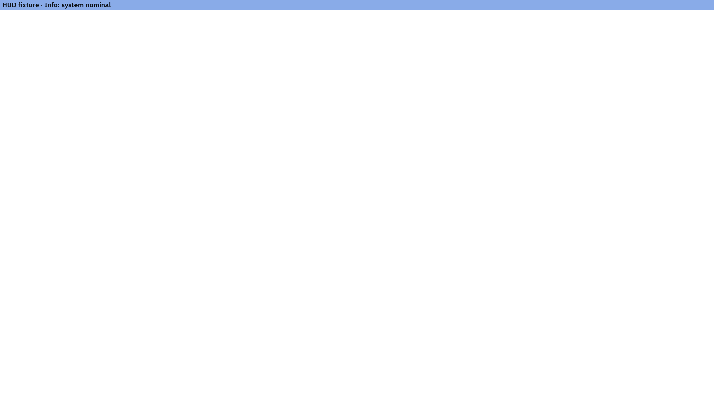
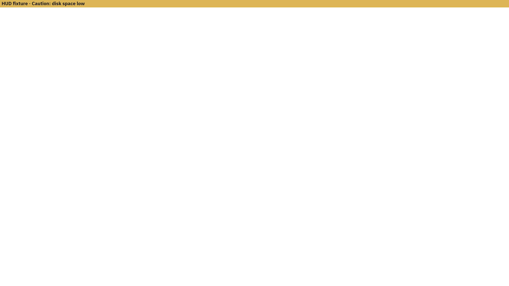
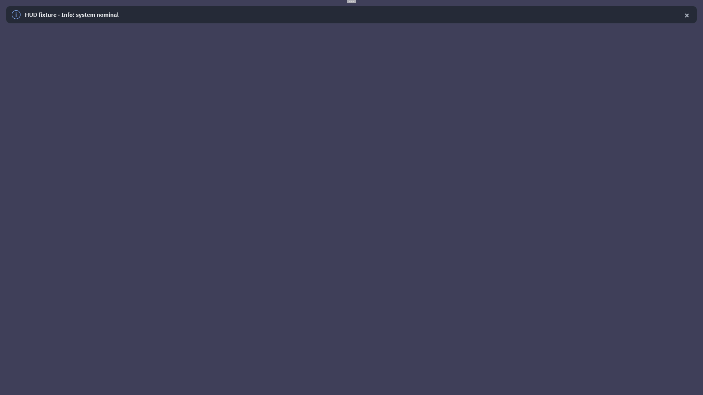
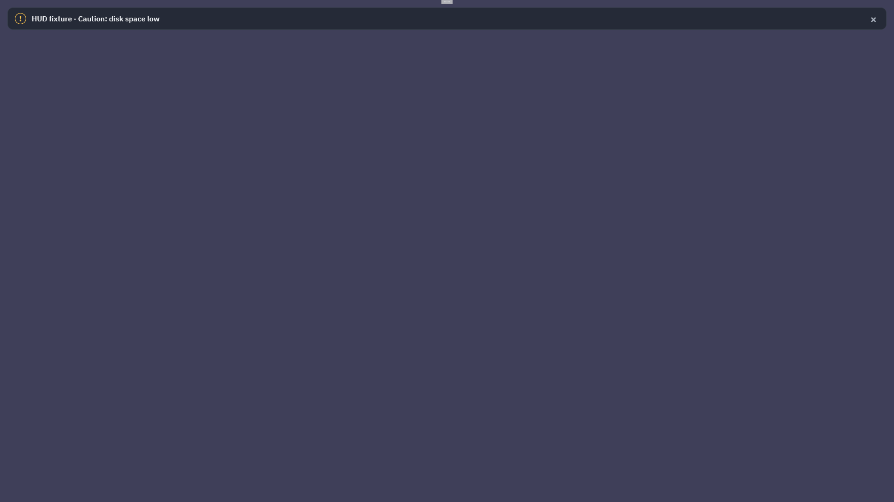
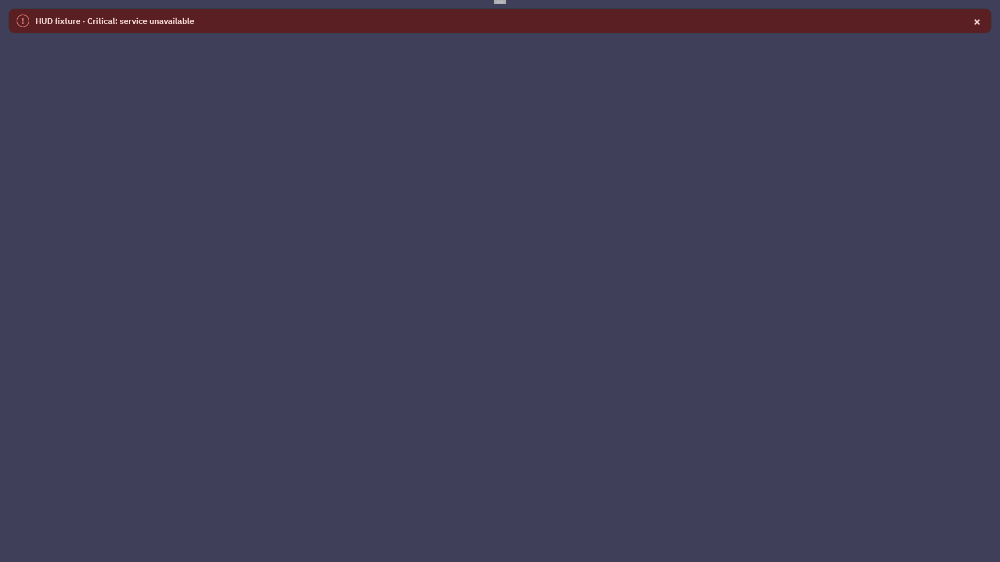
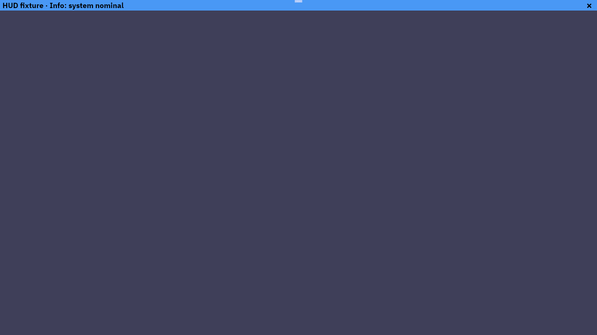
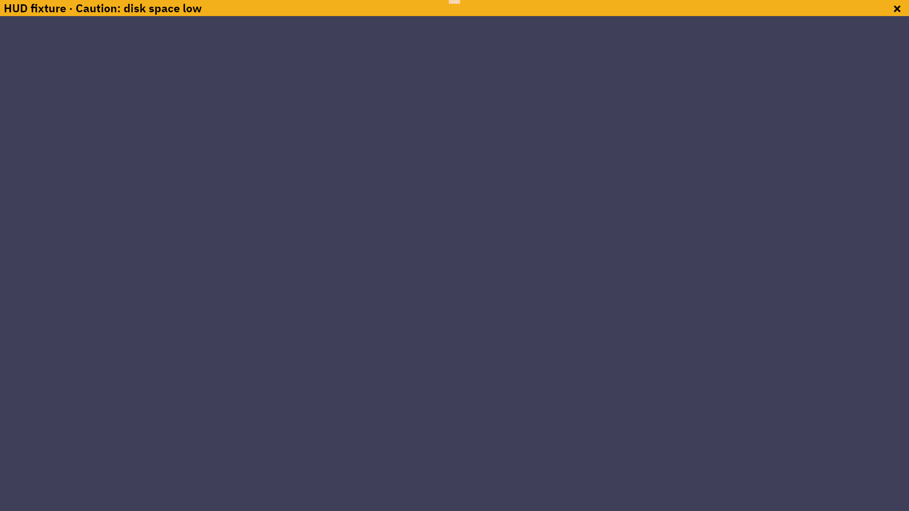
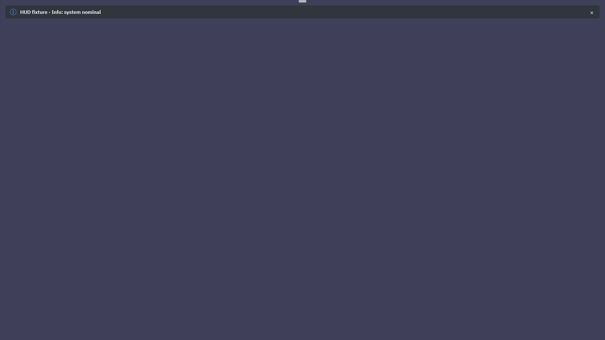
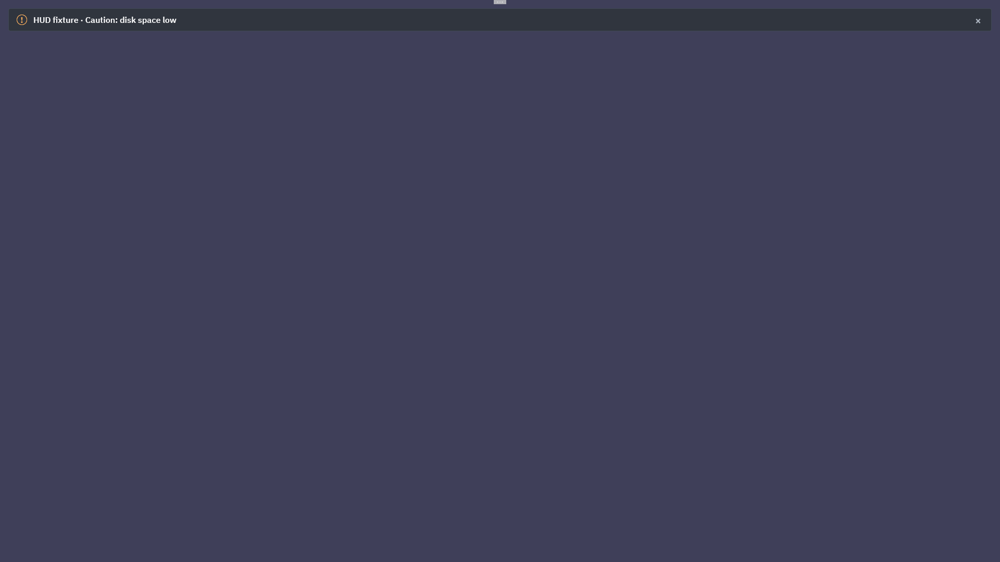
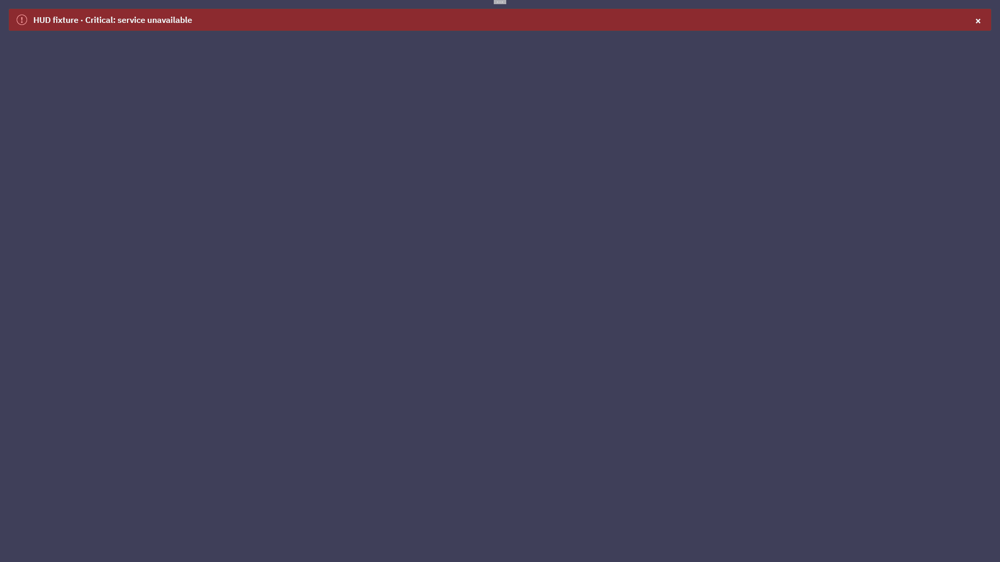

# Alert banner evidence

BEFORE is an own-frame capture from the paired owner HUD, build `24818c39`, on display 1 at 3840×2160. Existing theme and scale were unchanged and are not reported by that build's status API. [before.json](before.json) records the hashes and provenance.

AFTER uses the repository's `just render-scene` production startup and windowed capture path with llvmpipe at 1920×1080, UI and monitor scale 1.0, checkpoint 1000 ms. [after.json](after.json) records source head, fixture and resolved-token hashes, renderer and PNG hashes. Only evidence files are added after that captured source head.

The payload text and urgency match across BEFORE and AFTER. Captures are sequential one-banner fixtures: this pairing has one publication slot, so no simultaneous stack is claimed. Existing GPU tests cover distinct-publisher severity ordering. The 4K software capture attempt exceeded the headless device's 2048-pixel limit; these captures therefore cannot establish pixel parity with the owner's different environment. Windows owner sign-off remains in `hud-h51u7.4.6`.

| Severity | Owner BEFORE |
| --- | --- |
| info |  |
| caution |  |
| critical |  |

| Theme | Info | Caution | Critical |
| --- | --- | --- | --- |
| tonal-glass |  |  |  |
| classic |  |  |  |
| blueprint |  |  |  |
